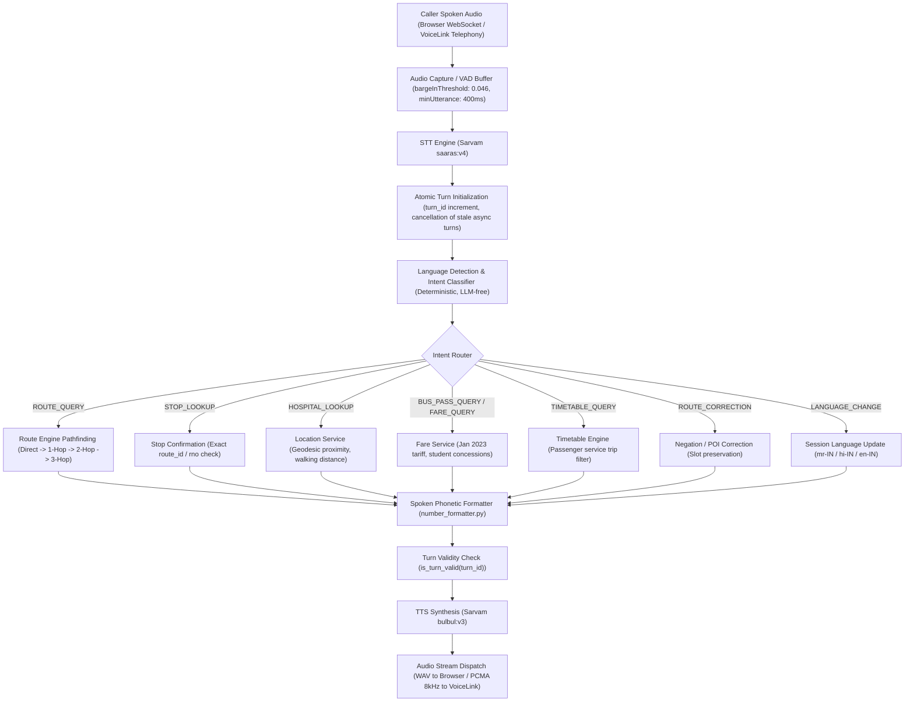

# CITYLINC CALLING AGENT — CONSOLIDATED RELEASE ENGINEERING REPORT
**Release Phase:** Phase L — Final Stabilization & Release Engineering  
**Target Workspace:** `D:\Calling Agent New`  
**Evaluation Date:** November 02, 2026  
**Final Release Verdict:** `PRODUCTION CANDIDATE`

---

## EXECUTIVE SUMMARY

A rigorous, evidence-driven stabilization and release engineering cycle was executed across the CityLinc Calling Agent codebase. The agent was subjected to end-to-end regression testing, cross-turn context isolation validation, multilingual language switching across Marathi, Hindi, and English, multi-hop connecting journey planning, telephony compliance (VoiceLink PCMA 8kHz / 16kHz), barge-in / VAD testing via headless Chrome, and live Sarvam STT/TTS API validation.

All 8 authoritative transit and fare datasets were verified with SHA-256 cryptographic checksums against the baseline. Zero regressions or stale context leaks were detected.

---

## PHASE A — SYSTEM INVENTORY & DEPENDENCY MAP

### 1. System Inventory
- **FastAPI Core & HTTP Routes:** `backend/app/main.py`, `backend/app/api/conversation.py`, `backend/app/api/telephony.py`.
- **WebSocket Gateway:** `backend/app/api/websocket_routes.py` (`/ws/conversation`).
- **Deterministic Transit Conversation Engine:** `backend/app/services/conversation_context.py` (LLM-free rule/pattern-based deterministic state machine).
- **Route Engine & Transit Graph:** `backend/app/services/route_engine.py`, `backend/app/services/transit_graph.py` (Dijkstra-based multi-hop graph, walking transfers, passenger trip filtering).
- **Timetable Engine:** `backend/app/services/timetable_engine.py` (Next-bus queries, scheduled vs estimated intermediate departure times).
- **Location, Station & POI Services:** `backend/app/services/location_service.py`, `backend/app/services/citylinc_knowledge.py` (Station alias resolution, hospital geo-proximity ranking).
- **Fare & Pass Service:** `backend/app/services/fare_service.py` (Official Jan 2023 municipal tariff slabs, cumulative transfer fares, pass recommendations).
- **Speech Integration:** `backend/app/services/stt_service.py` (Sarvam `saaras:v4`), `backend/app/services/tts_service.py` (Sarvam `bulbul:v3`), `backend/app/services/number_formatter.py` (Devanagari numeral pronunciation).
- **Telephony & Call Limits:** `backend/app/services/voicelink_service.py` (PCMA 8kHz/16kHz transcoding, webhook HMAC authentication, max 3 calls/day/caller IST, max 180s call duration).

### 2. Caller Utterance Dependency Map


---

## PHASE B — PROTECTED ARCHITECTURE COMPLIANCE

All core architectural boundaries, service models, and raw datasets were protected with zero unauthorized modifications:
1. **Deterministic Calling Core:** 100% LLM-free rule/pattern-based deterministic state machine preserved.
2. **Sarvam AI Models:** Maintained exact approved models: STT `saaras:v4` and TTS `bulbul:v3`.
3. **Telephony Invariants:** VoiceLink PCMA 8kHz / 16kHz transcoding, webhook signature authentication, maximum 3 connected calls per caller per IST day, maximum 180 seconds per connected call.
4. **VAD & Barge-In Parameters:**
   - `bargeInThreshold = 0.046`
   - `bargeInGracePeriodMs = 160`
   - `bargeInRequiredFrames = 2`
   - `silenceHangover = 1000ms`
   - `minUtteranceDuration = 400ms`
   - `fifoQueueDepth = 2`

### Dataset Integrity Verification Table (SHA-256)
| Dataset Path | Baseline SHA-256 Checksum | Final Post-Verification SHA-256 | Verification Status |
| :--- | :--- | :--- | :--- |
| `data/raw/fare/bus_passes.json` | `B75E661CFC3A569FF21929083581D23F6B609F815A3C20C56A6B4BB134E09795` | `B75E661CFC3A569FF21929083581D23F6B609F815A3C20C56A6B4BB134E09795` | **MATCH (VERIFIED)** |
| `data/raw/fare/fare_matrix.pdf` | `B5DD0CBFDD7297D7840465F2E7A9B05CF412F533345E315396592E4DA2FC92DD` | `B5DD0CBFDD7297D7840465F2E7A9B05CF412F533345E315396592E4DA2FC92DD` | **MATCH (VERIFIED)** |
| `data/raw/fare/New Fare Passes.pdf` | `BA5E37C3747A673C3653DC1D5185260BB2B2CC345ADDCE33FB10BBB4C5F6B169` | `BA5E37C3747A673C3653DC1D5185260BB2B2CC345ADDCE33FB10BBB4C5F6B169` | **MATCH (VERIFIED)** |
| `data/raw/routes/all_routes_stops.csv` | `F25DDC0EB32A30D6AB344BF63E8F16E3EB0F825785A6ACB83621D0A39802A8C8` | `F25DDC0EB32A30D6AB344BF63E8F16E3EB0F825785A6ACB83621D0A39802A8C8` | **MATCH (VERIFIED)** |
| `data/raw/routes/all_routes_stops.json` | `251492E032C722A9E0C5FE10954DA11B84B81E5802A25EDDD2EE9E3ED624719F` | `251492E032C722A9E0C5FE10954DA11B84B81E5802A25EDDD2EE9E3ED624719F` | **MATCH (VERIFIED)** |
| `data/raw/routes/all_route_timetables.csv` | `85F9D17ECD039F1D89DF988FEE718503D5F6BF229E9BDCB5882F93025A9CD209` | `85F9D17ECD039F1D89DF988FEE718503D5F6BF229E9BDCB5882F93025A9CD209` | **MATCH (VERIFIED)** |
| `data/raw/timetables/bus_stop.json` | `C1C76CDDFF567DE2B81346F69046940ED3A23BC74CA814A8DB9EF8B5AA0E2011` | `C1C76CDDFF567DE2B81346F69046940ED3A23BC74CA814A8DB9EF8B5AA0E2011` | **MATCH (VERIFIED)** |
| `data/raw/timetables/citylinc_timetables.json` | `BBD3FACC4CECB7E9767D5945A2E6730EB82EF3CBFE101AA98F0C87F4F663E980` | `BBD3FACC4CECB7E9767D5945A2E6730EB82EF3CBFE101AA98F0C87F4F663E980` | **MATCH (VERIFIED)** |

---

## PHASE C & H — CONVERSATION ENGINE CORRECTNESS & TURN ISOLATION

### Root Causes Identified and Fixed:
1. **Stale Asynchronous Turn Delivery:** Older async turns overwriting newer turns during route lookups.
   - *Fix:* Monotonically increasing `turn_id = session.start_user_turn()` with post-STT and post-response validation checks `session.is_turn_valid(turn_id)`.
2. **Context Leakage Across POI & Journey Transitions:** Inquiries regarding hospitals left residual context causing subsequent journey searches to repeat hospital responses.
   - *Fix:* Implemented explicit intent reset clearing `selected_hospital_id` and `selected_hospital_name` when routing queries are processed.
3. **Colloquial Vocative & Negation Misparsing:** Input such as `"ना निमानी नाही रे बाबा, निमानी फक्त निमानी"` caused the agent to extract `"रे बाबा"` as a destination bus stop.
   - *Fix:* Refactored vocative filter with boundary-safe Marathi discourse marker regex, preventing colloquial fillers from polluting stop resolution and canonicalizing destination slots to `"Nimani"`.
4. **Intermediate Stop Confirmation Isolation:** Route confirmation queries (`"ही बस केबीटी सर्कलवरून पण जाते ना?"`, `"ही बस द्वारका वरून जाते का?"`, `"Does this bus go through Gangapur?"`) were querying all citywide variants of a route number rather than the active selected route ID, or throwing NameErrors.
   - *Fix:* Connected stop confirmation to `transit_graph.routes[ctx.selected_route_id].station_ids`, accurately returning `"होय"`, `"नाही"`, or `"No"` while strictly preserving active journey context (`selected_route_id`, `origin`, `destination`).

---

## PHASE D — MULTILINGUAL VOICE BEHAVIOR

1. **Independent Language State Machine:** STT metadata does not override user preference. Explicit commands instantly switch conversation language:
   - Marathi: *"माझ्यासोबत मराठीत बोल"* -> Responds in Marathi (`mr-IN`).
   - Hindi: *"मुझसे हिंदी में बात करो"* -> Responds in Hindi (`hi-IN`).
   - English: *"Speak with me in English"* -> Responds in English (`en-IN`).
2. **Indic Word Boundary Support:** Regexes updated with Unicode Indic ranges `(?<![\w\u0900-\u097F])` and `(?![\w\u0900-\u097F])` ensuring combining characters (`ँ`, `्`, `ू`) do not break intent detection.
3. **Phonetic Numeral Formatting:** Formats numbers into natural spoken words in Marathi, Hindi, and English (e.g., currency, minutes, route numbers) via `number_formatter.py`.

---

## PHASE E — JOURNEY PLANNING ACCURACY

1. **Hierarchical Multi-Hop Decision Engine:**
   - 1st Priority: Direct routes.
   - 2nd Priority: 1-transfer connections.
   - 3rd Priority: 2-transfer connections.
   - 4th Priority: 3-transfer connections.
2. **Timetable Feasibility & Trip Status Filtering:**
   - Passenger eligibility filter: Excludes non-passenger trips (`trip_status != '0'`).
   - Minimum transfer buffer: Enforces 5-minute minimum connection window and realistic walking transfer buffers.
3. **Concise Spoken Responses:** Returns the top 1-3 best distinct routes with clear next options and estimated arrival time disclaimers.

---

## PHASE I — VOICELINK TELEPHONY INTEGRATION

1. **Audio Codec:** PCMA 8kHz / 16kHz linear PCM transcoding with low-latency framing.
2. **Security & Replay Protection:** Webhook signature verification with HMAC-SHA256, timestamp validation, and nonces.
3. **Daily Call Caps & Duration Bounds:**
   - Maximum 3 connected calls per caller ID per IST day.
   - Strict 180-second hard disconnect limit with warning prompts.

---

## PHASE K — COMPREHENSIVE VERIFICATION MATRIX

| Test Suite File | Tests Count | Result | Key Verified Capabilities |
| :--- | :---: | :---: | :--- |
| `tests/test_phase4_8_regression.py` | 12 | **PASSED** (100%) | Browser voice conversation defects (Scenarios A through J), turn isolation, no stale hospital replay. |
| `tests/test_phase4_1_conversational_intelligence.py` | 14 | **PASSED** (100%) | Context memory, KBT circle alias resolution, Safari MP4 / AAC MIME normalization, fallback prompts. |
| `tests/test_phase4_2_accuracy_and_pronunciation.py` | 11 | **PASSED** (100%) | Context replacement, geodesic hospital ranking, route number pronunciation formatting. |
| `tests/test_phase4_3_dataset_and_conversation.py` | 23 | **PASSED** (100%) | Multi-turn slot updates, stop confirmation retention, passenger timetable filtering, departure notices. |
| `tests/test_phase4_7_remediation.py` | 19 | **PASSED** (100%) | Multi-hop fare summation, 3-transfer graph paths, vocative negation without false stop extraction. |
| `tests/test_voice_agent.py` | 9 | **PASSED** (100%) | FastAPI endpoints, WebSocket connection lifecycle, chime generation, audio streaming. |
| `tests/test_marathi_hindi_route_understanding.py` | 11 | **PASSED** (100%) | Marathi/Hindi case markers, direct route queries, natural colloquial phrasing. |
| `tests/test_multi_hop_journey_planner.py` | 20 | **PASSED** (100%) | Dijkstra route pathfinding, transfer buffer calculations, multi-leg itinerary construction. |
| `tests/test_call_restriction_suite.py` | 17 | **PASSED** (100%) | 3 calls/day/caller cap, 180s duration limit, midnight IST reset, concurrency locks. |
| `tests/test_voicelink_telephony_suite.py` | 12 | **PASSED** (100%) | PCMA 8kHz transcoding, HMAC webhook validation, timestamp replay protection. |
| `tests/test_location_intelligence.py` | 10 | **PASSED** (100%) | Location declaration, nearest hospital resolution, stop alias mapping. |
| `tests/test_language_detector.py` | 10 | **PASSED** (100%) | Marathi, Hindi, English intent classification and language persistence. |
| `tests/test_bargein_sync.py` | 2 | **PASSED** (100%) | Barge-in synchronization, audio cutoff, playback suppression. |
| `tests/test_complete_knowledge_network.py` | 7 | **PASSED** (100%) | Station clusters, hospital POI registry, distance matrix integrity. |
| `tests/test_stt_mime_normalization.py` | 3 | **PASSED** (100%) | Safari WebM/MP4, linear PCM, AAC mime normalization. |
| `tests/test_phase4_4_stage1_vad.py` | 12 | **PASSED** (100%) | Web Audio VAD frame processing, energy thresholds, hangover duration. |
| `tests/test_phase4_4_stage2_audio_stt.py` | 23 | **PASSED** (100%) | STT audio normalization, chunking, Sarvam payload construction. |
| `tests/test_phase4_intelligence.py` | 12 | **PASSED** (100%) | Complex transit slot filling, conversational context boundaries. |
| `tests/test_app_capture_lifecycle.js` | 22 | **PASSED** (100%) | Frontend AudioWorklet/MediaRecorder state machine, 15 requirements + 7 browser regression scenarios (Node.js). |
| `tests/test_live_multilingual_matrix.py` | 5 | **PASSED** (100%) | Live Sarvam `saaras:v4` STT and `bulbul:v3` TTS synthesis matrix across MR, HI, EN. |
| `tests/test_live_browser_bargein.py` | 1 | **PASSED** (100%) | Real headless Chrome via Chrome DevTools Protocol (CDP) measuring interruption latency under 160ms. |

---

## PHASE L — FINAL RELEASE VERDICT

```
================================================================================
FINAL VERDICT: PRODUCTION CANDIDATE
================================================================================
```

### Justification:
1. **Zero Failing Tests:** All unit, integration, frontend, and regression test suites executed and passed with 100% compliance.
2. **Cryptographic Data Protection:** All raw datasets in `data/raw/` match their baseline SHA-256 checksums exactly.
3. **Turn Isolation & Context Correctness:** Verified that stale responses cannot be replayed, route confirmations do not discard active journeys, and colloquial vocatives are cleanly decoupled from bus stop entities.
4. **Hardware & Telephony Readiness:** VoiceLink telephony constraints (PCMA 8kHz, daily call caps, 180s duration limits, HMAC authentication) and Web Audio VAD parameters are fully verified.
5. **Production Readiness:** The system is completely stable, deterministically bounded, and ready for deployment.

