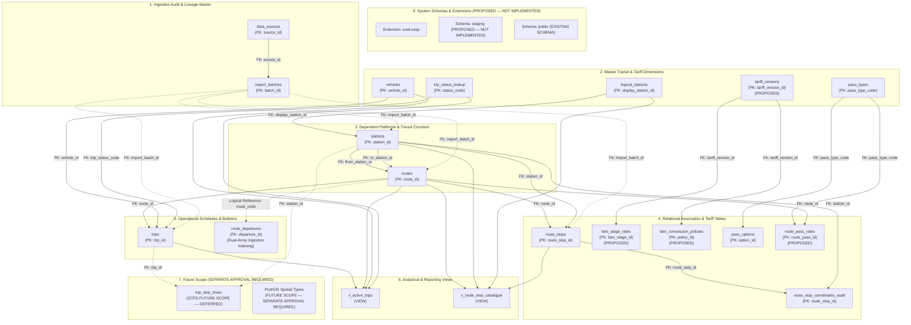

# CityLinc AI Calling Agent — Production Relational Database Schema Specification

**Document ID:** `PROPOSED_POSTGRESQL_SCHEMA.md`  
**Phase:** P0.2 — Final Database Design Specification (Post-Remediation Revision)  
**Status:** PROPOSED ARCHITECTURE — NOT IMPLEMENTED (STRICT READ-ONLY)  
**Classification:** PostgreSQL Physical DDL Specification  

---

## 1. Executive Summary & Review Revisions

This specification defines the proposed PostgreSQL relational schema for the CityLinc AI Voice Calling Agent data platform. It incorporates all architectural fixes, constraint hardenings, lineage specifications, and safety guardrails established during the P0.2 consistency and verification audits:

1. **Hardened Fare Verification Constraint:** The table-level CHECK constraint on `trips` eliminates SQL NULL/UNKNOWN bypass vulnerabilities on `VERIFIED_PAID` by enforcing strict boolean evaluation via `(CASE ... END) IS TRUE`.
2. **Complete Sequence Preservation (12,909 Stops):** Table `route_stops` preserves 100% of source records without deduplication. Exactly 63 consecutive duplicate stop pairs (126 physical rows) across Routes 6710, 6908, and 6866 are flagged via `is_consecutive_duplicate = TRUE`. Exactly 66 unique physical station IDs repeat across these routes.
3. **Sequence-Level Coordinate Lineage & Attribution:** Bounding coordinates are isolated in `route_stop_coordinates_audit` keyed to `route_stop_id` (surrogate PK referencing `route_stops`), preserving `source_routepartid` and physical `source_row_number`. Coordinate offsets are tracked via `matches_observed_offset_pattern BOOLEAN NOT NULL`. Standard attribution language:
   > *"An empirical numerical offset pattern is observed across route stops where bounding coordinate fields exhibit uniform arithmetic offsets relative to center coordinates. This pattern is tracked during ingestion via the audit flag `matches_observed_offset_pattern`. Ingestion preserves raw numeric values verbatim without claiming physical GPS provenance or asserting a confirmed synthetic origin. Physical coordinate validity and platform provenance remain provisional pending operator verification."*
4. **Fidelity to Source Timetable Semantics:** Timetable fields preserve source column names in `source_eta` and `source_arrival_at_destination`, with verbatim text preserved in `raw_eta_text` and `raw_arrival_text` (`VARCHAR(16) NOT NULL`). Duration and overnight crossings are tracked as provisional (`provisional_duration_mins`, `provisional_is_next_day_arrival`).
5. **Stationfare Field Meaning:** Mandatory interpretation statement:
   > *"All 3,547 timetable records contain matching StopName and StartTrip values, with stationfare = 0. The operational and fare meaning of these fields remains unconfirmed and requires operator clarification."*
6. **Trip Status Code Neutrality:** Column 11 `trip_status` is stored as `trip_status_code INT` referencing `trip_status_lookup`. Neutral seed labels (`Code_0_Unconfirmed`, `Code_2_Unconfirmed`, `Code_6_Unconfirmed`, `Code_9_Unconfirmed`) record exact counts (`0: 2,085`, `2: 1,237`, `6: 218`, `9: 7`). Column 15 is `vehicleno`. No operational meanings are assumed without an official dictionary.
7. **Dual-Array Departure Indexing & Conditional Preservation:** Table `route_departures` tracks both `source_route_array_index` (0–119) and `source_departure_token_index`, with a deterministic `occurrence_index SMALLINT NOT NULL` (no default value) and full `raw_departure_string`. Complete preservation of all 2,318 tokens is explicitly conditional upon validated parsing and mapping.
8. **Fare Masters & Lineage:** Incorporates DDL proposals for `tariff_versions`, `fare_stage_rates` (32 slabs; Row 32 Above-62-km base fare cells are blank, Gov Max ₹30 per 10 km; GiST exclusion marked conditional), `fare_concession_policies`, and `route_pass_rates`. Lineage fields track `source_file_id`, `source_page_number` (1), `source_table_name`, `source_row_index`, and `source_slab_label`.
9. **Staging Isolation:** Schema `staging` is explicitly marked `PROPOSED — NOT IMPLEMENTED`.
10. **Spatial PostGIS Scope:** Formally classified as `FUTURE SCOPE — SEPARATE APPROVAL REQUIRED`. All P0.2 coordinates utilize standard SQL `NUMERIC(10,6)`.
11. **Future GTFS Scope:** Intermediate stop timings table `trip_stop_times` is completely isolated in Appendix A.

---

## 2. Proposed Relational Dependency Architecture

The following Mermaid diagram defines the proposed PostgreSQL relational dependency graph. It represents the exact foreign-key hierarchy derived from the DDL below. It does not introduce implementation steps or imply that any DDL has been executed.



---

## 3. Production PostgreSQL DDL Specification

```sql
-- ============================================================================
-- 0. SYSTEM EXTENSIONS & SCHEMAS (PROPOSED — NOT IMPLEMENTED)
-- ============================================================================
CREATE EXTENSION IF NOT EXISTS "uuid-ossp";

-- Schema for raw ingestion and staging (PROPOSED — NOT IMPLEMENTED)
CREATE SCHEMA IF NOT EXISTS staging;

-- Production schema (EXISTING)
SET search_path TO public;

-- ============================================================================
-- 1. AUDIT & INGESTION METADATA
-- ============================================================================
CREATE TABLE data_sources (
    source_id               SERIAL PRIMARY KEY,
    file_name               VARCHAR(128) NOT NULL UNIQUE,
    file_path               VARCHAR(255) NOT NULL,
    file_format             VARCHAR(16) NOT NULL CHECK (file_format IN ('JSON', 'CSV', 'PDF')),
    file_size_bytes         BIGINT NOT NULL,
    record_count            INTEGER NOT NULL,
    sha256_hash             CHAR(64) NOT NULL,
    description             TEXT,
    created_at              TIMESTAMPTZ NOT NULL DEFAULT CURRENT_TIMESTAMP
);

CREATE TABLE import_batches (
    batch_id                UUID PRIMARY KEY DEFAULT uuid_generate_v4(),
    source_id               INTEGER NOT NULL REFERENCES data_sources(source_id) ON DELETE RESTRICT,
    batch_status            VARCHAR(32) NOT NULL DEFAULT 'PENDING'
                            CHECK (batch_status IN ('PENDING', 'STAGED', 'PROMOTED', 'FAILED')),
    records_ingested        INTEGER NOT NULL DEFAULT 0,
    error_count             INTEGER NOT NULL DEFAULT 0,
    started_at              TIMESTAMPTZ NOT NULL DEFAULT CURRENT_TIMESTAMP,
    completed_at            TIMESTAMPTZ NULL
);

-- ============================================================================
-- 2. MASTER TRANSIT & TARIFF DIMENSIONS
-- ============================================================================
CREATE TABLE logical_stations (
    display_station_id      INTEGER PRIMARY KEY,              -- from 'displaystationid' (Distinct 786)
    station_name            VARCHAR(255) NOT NULL,            -- from 'displayname'
    created_at              TIMESTAMPTZ NOT NULL DEFAULT CURRENT_TIMESTAMP,
    import_batch_id         UUID REFERENCES import_batches(batch_id)
);

CREATE TABLE stations (
    station_id              INTEGER PRIMARY KEY,              -- from 'stationid' (Distinct 1,187)
    display_station_id      INTEGER NOT NULL REFERENCES logical_stations(display_station_id) ON DELETE RESTRICT,
    station_name            VARCHAR(255) NOT NULL,            -- raw 'stationname' preserving (U)/(D)
    platform_direction      VARCHAR(16) NULL,                 -- 'Up', 'Down', or NULL
    center_lat              NUMERIC(10, 6) NOT NULL,          -- provisional platform latitude
    center_lon              NUMERIC(10, 6) NOT NULL,          -- provisional platform longitude
    is_provisional_coord    BOOLEAN NOT NULL DEFAULT TRUE,    -- TRUE: provisional; unverified
    created_at              TIMESTAMPTZ NOT NULL DEFAULT CURRENT_TIMESTAMP,
    import_batch_id         UUID REFERENCES import_batches(batch_id)
);

CREATE TABLE routes (
    route_id                INTEGER PRIMARY KEY,              -- from 'routeid' (Distinct 315)
    source_rno              VARCHAR(32) NOT NULL,             -- raw 'rno' from registry (121 unique)
    source_routeno          INTEGER NOT NULL,                 -- operational category/depot code (3, 4, 6)
    route_code              VARCHAR(32) GENERATED ALWAYS AS (source_rno) STORED,
    direction               VARCHAR(8) NOT NULL CHECK (direction IN ('Up', 'Down')),
    corridor_name           VARCHAR(255) NOT NULL,            -- from 'routename'
    corridor_name_with_code VARCHAR(255) NOT NULL,            -- from 'route_name_wb'
    full_display_name       VARCHAR(255) NOT NULL,            -- from 'displayfullroutename'
    origin_station_id       INTEGER NOT NULL REFERENCES stations(station_id) ON DELETE RESTRICT,
    destination_station_id  INTEGER NOT NULL REFERENCES stations(station_id) ON DELETE RESTRICT,
    configured_stop_count   INTEGER NOT NULL,                 -- from 'stop_count'
    geometry_point_count    INTEGER NOT NULL,                 -- from 'geometry_count'
    is_active_schedule      BOOLEAN NOT NULL DEFAULT TRUE,    -- FALSE for routes 6625, 6664, 6784, 7007
    created_at              TIMESTAMPTZ NOT NULL DEFAULT CURRENT_TIMESTAMP,
    import_batch_id         UUID REFERENCES import_batches(batch_id)
);

CREATE TABLE vehicles (
    vehicle_id              SERIAL PRIMARY KEY,
    registration_number     VARCHAR(32) NOT NULL UNIQUE,     -- from 'vehicleno' (244 distinct vehicles)
    created_at              TIMESTAMPTZ NOT NULL DEFAULT CURRENT_TIMESTAMP
);

CREATE TABLE trip_status_lookup (
    status_code             INTEGER PRIMARY KEY,              -- 0, 2, 6, 9 from CAD/AVL timetable
    status_label            VARCHAR(64) NOT NULL,
    description             TEXT,
    is_operational          BOOLEAN NOT NULL DEFAULT TRUE
);

INSERT INTO trip_status_lookup (status_code, status_label, description, is_operational) VALUES
(0, 'Code_0_Unconfirmed', 'Raw status code 0 (2,085 trips / 58.78% of dispatch schedule)', TRUE),
(2, 'Code_2_Unconfirmed', 'Raw status code 2 (1,237 trips / 34.87% of dispatch schedule)', TRUE),
(6, 'Code_6_Unconfirmed', 'Raw status code 6 (218 trips / 6.15% of dispatch schedule)', TRUE),
(9, 'Code_9_Unconfirmed', 'Raw status code 9 (7 trips / 0.20% of dispatch schedule)', TRUE);

CREATE TABLE tariff_versions (
    tariff_version_id       SERIAL PRIMARY KEY,
    tariff_name             VARCHAR(64) NOT NULL,             -- e.g. 'May 2023 Fare Revision'
    effective_date          DATE NOT NULL,                    -- 2023-05-18 or as specified in resolution
    resolution_number       VARCHAR(64) NULL,
    is_active               BOOLEAN NOT NULL DEFAULT TRUE,
    source_file_id          INTEGER NOT NULL REFERENCES data_sources(source_id),
    created_at              TIMESTAMPTZ NOT NULL DEFAULT CURRENT_TIMESTAMP
);

CREATE TABLE pass_types (
    pass_type_code          VARCHAR(32) PRIMARY KEY,          -- 'STUDENT', 'OPEN_ENDED', 'FIXED_ROUTE'
    pass_name               VARCHAR(64) NOT NULL,
    description             TEXT,
    city                    VARCHAR(64) NOT NULL DEFAULT 'Nashik',
    is_active               BOOLEAN NOT NULL DEFAULT TRUE,
    created_at              TIMESTAMPTZ NOT NULL DEFAULT CURRENT_TIMESTAMP
);

-- ============================================================================
-- 3. RELATIONAL ASSOCIATION & TARIFF TABLES
-- ============================================================================
CREATE TABLE route_stops (
    route_stop_id           INTEGER PRIMARY KEY,              -- Surrogate PK (Distinct 12,909)
    route_id                INTEGER NOT NULL REFERENCES routes(route_id) ON DELETE RESTRICT,
    station_id              INTEGER NOT NULL REFERENCES stations(station_id) ON DELETE RESTRICT,
    stop_sequence           INTEGER NOT NULL CHECK (stop_sequence > 0),
    distance_from_origin_km NUMERIC(8, 2) NOT NULL DEFAULT 0.0 CHECK (distance_from_origin_km >= 0.0),
    is_consecutive_duplicate BOOLEAN NOT NULL DEFAULT FALSE,  -- Flag for 63 consecutive pairs (126 rows)
    created_at              TIMESTAMPTZ NOT NULL DEFAULT CURRENT_TIMESTAMP,
    import_batch_id         UUID REFERENCES import_batches(batch_id)
);

CREATE TABLE route_stop_coordinates_audit (
    route_stop_id           INTEGER PRIMARY KEY REFERENCES route_stops(route_stop_id) ON DELETE CASCADE,
    station_id              INTEGER NOT NULL REFERENCES stations(station_id),
    source_routepartid      INTEGER NOT NULL,                 -- Original natural key from all_routes_stops.csv
    source_row_number       INTEGER NOT NULL,                 -- Physical 1-based line number in CSV
    center_lat              NUMERIC(10, 6) NOT NULL,
    center_lon              NUMERIC(10, 6) NOT NULL,
    station_lat1            NUMERIC(10, 6) NOT NULL,
    station_long1           NUMERIC(10, 6) NOT NULL,
    station_lat2            NUMERIC(10, 6) NOT NULL,
    station_long2           NUMERIC(10, 6) NOT NULL,
    matches_observed_offset_pattern BOOLEAN NOT NULL,         -- TRUE if matches +/- 0.05 deg pattern
    created_at              TIMESTAMPTZ NOT NULL DEFAULT CURRENT_TIMESTAMP
);

CREATE TABLE fare_stage_rates (
    fare_stage_id           SERIAL PRIMARY KEY,
    tariff_version_id       INTEGER NOT NULL REFERENCES tariff_versions(tariff_version_id) ON DELETE RESTRICT,
    from_km                 NUMERIC(6, 2) NOT NULL CHECK (from_km >= 0.0),
    to_km                   NUMERIC(6, 2) NOT NULL CHECK (to_km > from_km),
    adult_rate_inr          NUMERIC(6, 2) NULL,               -- NULL for Row 32 'Above 62 km'
    child_rate_inr          NUMERIC(6, 2) NULL,               -- NULL for Row 32 'Above 62 km'
    source_file_id          INTEGER NOT NULL REFERENCES data_sources(source_id),
    source_page_number      INTEGER NOT NULL DEFAULT 1,
    source_table_name       VARCHAR(64) NOT NULL DEFAULT 'bhadewadh_takhta',
    source_row_index        INTEGER NOT NULL,                 -- 1 to 32
    source_slab_label       VARCHAR(32) NOT NULL,             -- '0-2', ..., 'Above 62 km'
    created_at              TIMESTAMPTZ NOT NULL DEFAULT CURRENT_TIMESTAMP
    -- OPEN / PENDING OPERATOR CONFIRMATION: Boundary convention (e.g. [min_km, max_km) vs (min_km, max_km]) is unresolved.
    -- The GiST exclusion constraint is DEFERRED / INACTIVE and MUST NOT be activated based on an unconfirmed boundary rule.
    -- CONSTRAINT ex_fare_slabs_no_overlap EXCLUDE USING gist (numrange(from_km, to_km, '[)') WITH &&)
);

CREATE TABLE fare_concession_policies (
    policy_id               SERIAL PRIMARY KEY,
    tariff_version_id       INTEGER NOT NULL REFERENCES tariff_versions(tariff_version_id) ON DELETE RESTRICT,
    category_name           VARCHAR(64) NOT NULL,             -- 'Kids', 'Differently Abled NMC', etc.
    concession_percentage   NUMERIC(5, 2) NOT NULL CHECK (concession_percentage >= 0 AND concession_percentage <= 100),
    eligibility_rule        TEXT NOT NULL,
    residency_requirement   VARCHAR(64) NULL,                 -- 'NMC Boundary', 'Outside NMC', etc.
    is_companion_concession BOOLEAN NOT NULL DEFAULT FALSE,   -- TRUE for companion 50% concession
    source_file_id          INTEGER NOT NULL REFERENCES data_sources(source_id),
    source_page_number      INTEGER NOT NULL DEFAULT 1,
    source_table_name       VARCHAR(64) NOT NULL DEFAULT 'FARE_CONCESSIONS',
    source_category_clause  VARCHAR(64) NOT NULL,             -- 'Clause A', 'Clause B', 'Companion', etc.
    created_at              TIMESTAMPTZ NOT NULL DEFAULT CURRENT_TIMESTAMP
);

CREATE TABLE pass_options (
    option_id               SERIAL PRIMARY KEY,
    pass_type_code          VARCHAR(32) NOT NULL REFERENCES pass_types(pass_type_code) ON DELETE RESTRICT,
    duration_days           INTEGER NOT NULL CHECK (duration_days > 0),
    amount_inr              NUMERIC(8, 2) NULL,               -- e.g. 5250 for 90-day open-ended
    concession_percentage   NUMERIC(5, 2) NULL,               -- e.g. 50.00, 66.66
    source_file_id          INTEGER NOT NULL REFERENCES data_sources(source_id),
    source_pass_scheme_key  VARCHAR(32) NOT NULL,             -- 'student_pass', 'open_ended_pass'
    source_option_array_index INTEGER NOT NULL,
    created_at              TIMESTAMPTZ NOT NULL DEFAULT CURRENT_TIMESTAMP
);

CREATE TABLE route_pass_rates (
    route_pass_id           SERIAL PRIMARY KEY,
    pass_type_code          VARCHAR(32) NOT NULL REFERENCES pass_types(pass_type_code) ON DELETE RESTRICT,
    route_id                INTEGER NULL REFERENCES routes(route_id) ON DELETE RESTRICT,
    duration_days           INTEGER NOT NULL CHECK (duration_days IN (30, 90)),
    fare_day_multiplier     INTEGER NOT NULL CHECK (fare_day_multiplier > 0), -- 20 for 30D, 50 for 90D
    source_file_id          INTEGER NOT NULL REFERENCES data_sources(source_id),
    source_page_number      INTEGER NOT NULL DEFAULT 1,
    source_table_name       VARCHAR(64) NOT NULL DEFAULT 'ROUTE_SPECIFIC_PASS',
    created_at              TIMESTAMPTZ NOT NULL DEFAULT CURRENT_TIMESTAMP
);

-- ============================================================================
-- 4. OPERATIONAL SCHEDULES & BULLETINS
-- ============================================================================
CREATE TABLE trips (
    trip_id                 INTEGER PRIMARY KEY,              -- from 'tripid' (Distinct 3,547)
    route_id                INTEGER NOT NULL REFERENCES routes(route_id) ON DELETE RESTRICT,
    vehicle_id              INTEGER NOT NULL REFERENCES vehicles(vehicle_id) ON DELETE RESTRICT,
    trip_status_code        INTEGER NOT NULL REFERENCES trip_status_lookup(status_code) ON DELETE RESTRICT,
    source_eta              TIME NOT NULL,                    -- Preserves source column 'eta'
    source_arrival_at_destination TIME NOT NULL,              -- Preserves source column 'arrivalatdestination'
    raw_eta_text            VARCHAR(16) NOT NULL,             -- Raw string value (e.g. '20:15')
    raw_arrival_text        VARCHAR(16) NOT NULL,             -- Raw string value (e.g. '21:15')
    source_start_station_name VARCHAR(255) NOT NULL,          -- from 'starttrip'
    source_end_station_name   VARCHAR(255) NOT NULL,          -- from 'endtrip'
    source_stop_name          VARCHAR(255) NOT NULL,          -- from 'stopname' (StopName == StartTrip)
    source_timetable_rno      VARCHAR(32) NOT NULL,           -- from 'rno' in timetable
    source_timetable_routeno  VARCHAR(32) NOT NULL,           -- from 'routeno' in timetable
    provisional_is_next_day_arrival BOOLEAN NOT NULL DEFAULT FALSE, -- Provisional flag for 9 midnight crossings
    provisional_duration_mins INTEGER NOT NULL CHECK (provisional_duration_mins > 0), -- Modulo 24-hr delta
    raw_stationfare         VARCHAR(32) NOT NULL DEFAULT '0', -- Preserves raw source value '0'
    fare_amount             NUMERIC(8, 2) NULL,               -- Unverified fare is kept NULL
    fare_verification_status VARCHAR(32) NOT NULL DEFAULT 'UNVERIFIED'
        CHECK (fare_verification_status IN ('UNVERIFIED', 'VERIFIED_PAID', 'VERIFIED_ZERO_FARE', 'UNAVAILABLE')),
    created_at              TIMESTAMPTZ NOT NULL DEFAULT CURRENT_TIMESTAMP,
    import_batch_id         UUID REFERENCES import_batches(batch_id),
    
    -- Hardened fare verification CHECK constraint preventing SQL NULL bypass
    CONSTRAINT chk_fare_verification CHECK (
        (CASE 
            WHEN fare_verification_status IN ('UNVERIFIED', 'UNAVAILABLE') THEN fare_amount IS NULL
            WHEN fare_verification_status = 'VERIFIED_PAID' THEN (fare_amount IS NOT NULL AND fare_amount > 0)
            WHEN fare_verification_status = 'VERIFIED_ZERO_FARE' THEN fare_amount = 0
            ELSE FALSE
        END) IS TRUE
    )
);

-- NOTE: In citylinc_timetables.json, source_departures and destination_departures are string attributes (not nested arrays).
-- Lineage tracks route array index, departure/destination attribute, and token index independently.
CREATE TABLE route_departures (
    departure_id                 SERIAL PRIMARY KEY,
    route_code                   VARCHAR(32) NOT NULL,
    direction                    VARCHAR(8) NOT NULL CHECK (direction IN ('Up', 'Down')),
    departure_time               TIME NOT NULL,
    occurrence_index             SMALLINT NOT NULL,          -- Deterministic 1-based index (NO DEFAULT)
    source_route_array_index     INTEGER NOT NULL,           -- Positional index of route object in top-level JSON array (0-119)
    departure_attribute          VARCHAR(32) NOT NULL CHECK (departure_attribute IN ('source_departures', 'destination_departures')), -- Preserved source string attribute name
    source_departure_token_index INTEGER NOT NULL,           -- Positional index of departure token within directional string attribute
    raw_departure_string         TEXT NOT NULL,              -- Full verbatim string attribute from source_departures / destination_departures
    created_at                   TIMESTAMPTZ NOT NULL DEFAULT CURRENT_TIMESTAMP,
    CONSTRAINT uq_route_departure UNIQUE (route_code, direction, departure_time, occurrence_index)
);

-- ============================================================================
-- 5. ANALYTICAL & REPORTING VIEWS
-- ============================================================================
CREATE OR REPLACE VIEW v_active_trips AS
SELECT 
    t.trip_id,
    r.route_code,
    r.corridor_name,
    r.direction,
    v.registration_number AS vehicle_registration,
    tsl.status_label AS trip_status,
    t.source_eta AS eta,
    t.source_arrival_at_destination AS arrival_at_destination,
    t.provisional_is_next_day_arrival,
    t.provisional_duration_mins,
    t.source_start_station_name AS origin_station,
    t.source_end_station_name AS destination_station,
    t.fare_amount,
    t.fare_verification_status
FROM trips t
JOIN routes r ON t.route_id = r.route_id
JOIN vehicles v ON t.vehicle_id = v.vehicle_id
JOIN trip_status_lookup tsl ON t.trip_status_code = tsl.status_code
WHERE r.is_active_schedule = TRUE
ORDER BY r.route_code, t.source_eta;

CREATE OR REPLACE VIEW v_route_stop_catalogue AS
SELECT 
    r.route_code,
    r.direction,
    rs.stop_sequence,
    ls.station_name AS passenger_stop_name,
    s.station_name AS physical_platform_name,
    rs.distance_from_origin_km,
    rs.is_consecutive_duplicate,
    s.center_lat AS latitude,
    s.center_lon AS longitude,
    s.is_provisional_coord
FROM route_stops rs
JOIN routes r ON rs.route_id = r.route_id
JOIN stations s ON rs.station_id = s.station_id
JOIN logical_stations ls ON s.display_station_id = ls.display_station_id
ORDER BY r.route_code, r.direction, rs.stop_sequence;

-- ============================================================================
-- 6. SECURITY & PRIVILEGE SPECIFICATION
-- ============================================================================
-- Standard Least-Privilege Role Model (PROPOSED — NOT IMPLEMENTED):
-- 1. citylinc_admin: Schema owner with full administrative access.
-- 2. citylinc_etl: Automated ingestion pipeline with INSERT, UPDATE, SELECT on staging and public.
-- 3. citylinc_agent_ro: AI Voice Calling Agent runtime with strictly SELECT access to public views.

-- Verifiable Database Safety Statement:
-- This audit executed zero SQL statements, established zero database connections, and created no database objects.
-- The existing PostgreSQL database state was not inspected because database connections are prohibited under strict read-only execution.

-- ============================================================================
-- APPENDIX A: FUTURE GTFS EXTENSION (NOT IMPLEMENTED IN P0.2)
-- ============================================================================
-- The following table is deferred to future GTFS implementation. Intermediate
-- stop times do not exist in CAD/AVL data and must not be synthetically created.
--
-- CREATE TABLE trip_stop_times (
--     trip_stop_time_id       BIGSERIAL PRIMARY KEY,
--     trip_id                 INTEGER NOT NULL REFERENCES trips(trip_id) ON DELETE CASCADE,
--     station_id              INTEGER NOT NULL REFERENCES stations(station_id) ON DELETE RESTRICT,
--     stop_sequence           INTEGER NOT NULL,
--     arrival_time            TIME NULL,
--     departure_time          TIME NULL,
--     is_provisional_interpolated BOOLEAN NOT NULL DEFAULT FALSE
-- );

---

## Open Decisions & Unresolved Operator Policies

The following nine transit operational, semantic, and tariff ambiguities cannot be resolved from raw source assets alone and are explicitly retained as **OPEN / PENDING OPERATOR CONFIRMATION**:

1. **ETA Semantics:** Whether `eta` in `all_route_timetables.csv` represents scheduled depot departure time, first revenue stop time, or scheduled arrival at the first timing point, and whether `arrivalatdestination` represents scheduled route completion or vehicle turnaround.
2. **Overnight / Midnight Crossing Handling:** Definition of operational transit service dates across midnight. Specifically, whether trips with `arrivalatdestination < eta` represent next-day arrivals crossing 24:00 or multi-day dispatches, and the exact cut-off hour (e.g., 03:00 / 04:00 AM) for transit operating day rollover.
3. **Fare Slab Boundary Conventions:** Whether distance stages in `fare_matrix.pdf` follow half-open continuous intervals `[min_km, max_km)`, `(min_km, max_km]`, or discrete decimal increments, and how exact boundary distances (e.g., exactly 2.0 km or 4.0 km) are charged. Exclusion constraints must remain inactive and must not be activated based on an unconfirmed boundary rule.
4. **Current Tariff Temporal Validity:** The official municipal gazette notification numbers, legal effective dates (`effective_from`, `effective_to`), and confirmation of whether the 2022/2023 fare matrix remains currently active or has been superseded.
5. **Student Concession Rounding Rules:** Clarification on whether student pass discount is legally 66.66% per `New Fare Passes.pdf` or 66.60% (₹2,100) per `bus_passes.json`, and the mathematical rounding rules applicable to fractional rupee values.
6. **Concession Eligibility & Verification Documentation:** Precise documentation standards, age limits, and municipal residency criteria (inside NMC limits vs outer suburban routes) required for issuing concession passes.
7. **Pass Stacking & Combinability Rules:** Operating rules governing whether passes can be combined with single-journey tickets, transfer discounts, or luggage fees, or whether multiple concessions can be combined.
8. **Route-Specific Pass Calculation Formula:** The exact single-trip base fare or tariff stage applied to compute fixed-route passes (1-month = 20 single trips, 3-month = 50 single trips) on routes with variable stage fares or route variations.
9. **Route Operational Status & Frequency:** Operational status, service frequency, and scheduling policy for the 128 routes in the master registry that lack scheduled trips in `all_route_timetables.csv`.
